

  

  
  
  
  <!-- TODO: add a portfolio link here once you have one -->

<!-- Every animated image below is generated by scripts/generate_assets.py. Edit the text there and rerun it. -->

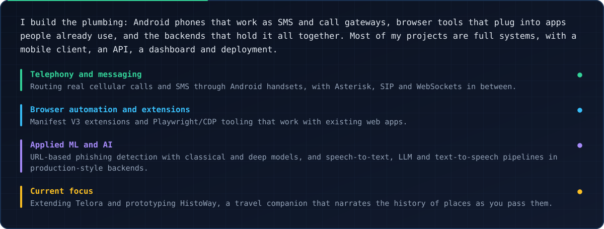

Currently building: <a href="https://github.com/Dhruthik0/Telora">Telora</a> · <a href="https://github.com/Dhruthik0/HistoWay">HistoWay</a>

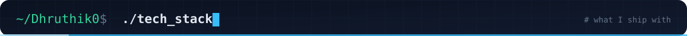
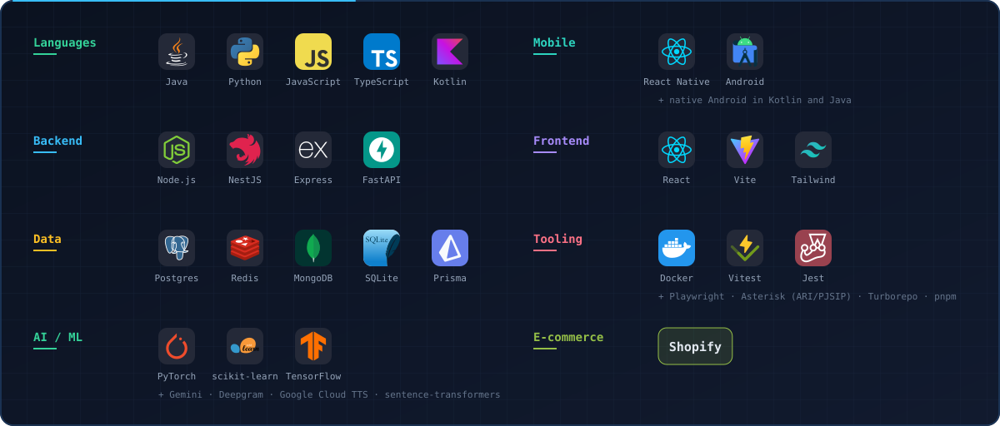

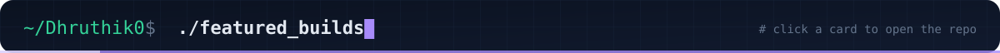

<a href="https://github.com/Dhruthik0/Telora">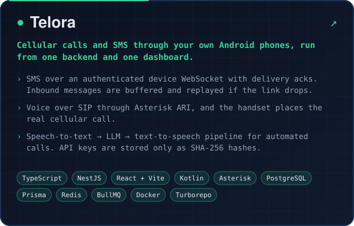</a>
<a href="https://github.com/Dhruthik0/Website-Authentication-extension-">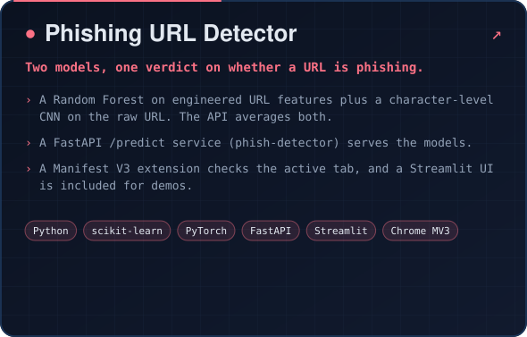</a>
<a href="https://github.com/Dhruthik0/varoza">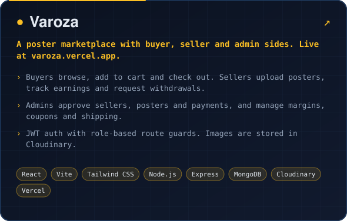</a>
<a href="https://github.com/Dhruthik0/ChatGPT-Gateway">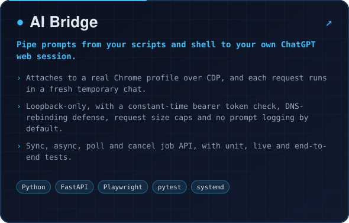</a>
<a href="https://github.com/Dhruthik0/FinLedger">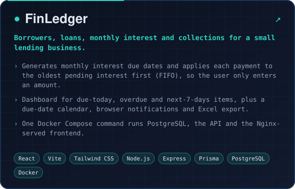</a>
<a href="https://github.com/Dhruthik0/sms-freebie">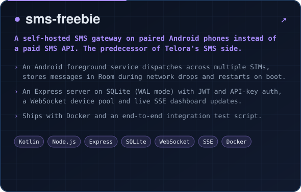</a>

Also: <a href="https://varoza.vercel.app">Varoza live site</a> · <a href="https://github.com/Dhruthik0/phish-detector">phish-detector model API</a>

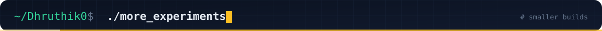

<a href="https://github.com/Dhruthik0/Chat-trace">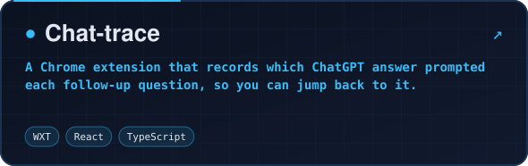</a>
<a href="https://github.com/Dhruthik0/Helpyy-ext">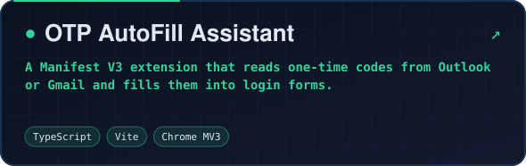</a>
<a href="https://github.com/Dhruthik0/resume-screen-agent">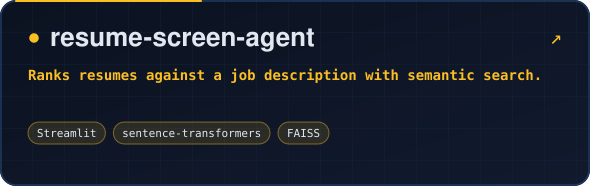</a>
<a href="https://github.com/Dhruthik0/emotion-detection">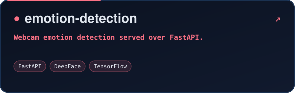</a>

<picture>
  <source media="(prefers-color-scheme: dark)" srcset="https://raw.githubusercontent.com/Dhruthik0/Dhruthik0/output/github-snake-dark.svg">
  
</picture>

<picture>
  <source media="(prefers-color-scheme: dark)" srcset="https://github-readme-stats.vercel.app/api/top-langs/?username=Dhruthik0&layout=compact&langs_count=6&hide_border=true&theme=github_dark">
  
</picture>

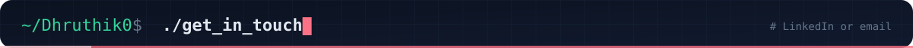

  
  

