  

  
  
  
  <!-- TODO: add a portfolio link here once you have one -->

I build the plumbing: Android phones that work as SMS and call gateways, browser tools that plug into apps people already use, and the backends that hold it all together. Most of my projects are full systems, with a mobile client, an API, a dashboard and deployment.

## ⚡ What I work on

- 📡 **Telephony and messaging.** Routing real cellular calls and SMS through Android handsets, with Asterisk, SIP and WebSockets in between.
- 🧩 **Browser automation and extensions.** Manifest V3 extensions and Playwright/CDP tooling that work with existing web apps.
- 🧠 **Applied ML and AI.** URL-based phishing detection with classical and deep models, and speech-to-text, LLM and text-to-speech pipelines in production-style backends.
- 🔭 **Current focus:** extending [Telora](https://github.com/Dhruthik0/Telora) and prototyping [HistoWay](https://github.com/Dhruthik0/HistoWay), a travel companion that narrates the history of places as you pass them.

## 🛠️ Tech stack

**Languages** 

**Mobile** 
 
React Native · native Android (Kotlin, Java)

**Backend** 

**Frontend** 

**E-commerce** 

**Data** 

**Tooling** 
 
Also: Playwright, Asterisk (ARI / PJSIP), Turborepo, pnpm

**AI / ML** 
 
Also: Gemini, Deepgram, Google Cloud Text-to-Speech, sentence-transformers

## 🚀 Featured builds

<table>
<tr>
<td width="50%" valign="top">

### 📞 [Telora](https://github.com/Dhruthik0/Telora)
**Cellular calls and SMS through your own Android phones, run from one backend and one dashboard.**

- SMS over an authenticated device WebSocket with delivery acks. Inbound messages are buffered and replayed if the link drops.
- Voice over SIP through Asterisk ARI, and the handset places the real cellular call.
- Speech-to-text → LLM → text-to-speech pipeline for automated calls. API keys are stored only as SHA-256 hashes.

TypeScript · NestJS · React + Vite · Kotlin · Asterisk · PostgreSQL + Prisma · Redis + BullMQ · Docker · Turborepo

</td>
<td width="50%" valign="top">

### 🎣 [Phishing URL Detector](https://github.com/Dhruthik0/Website-Authentication-extension-)
**Two models, one verdict on whether a URL is phishing.**

- A Random Forest on engineered URL features plus a character-level CNN on the raw URL. The API averages both.
- A FastAPI `/predict` service ([phish-detector](https://github.com/Dhruthik0/phish-detector)) serves the models.
- A Manifest V3 extension checks the active tab, and a Streamlit UI is included for demos.

Python · scikit-learn · PyTorch · FastAPI · Streamlit · Chrome extension (MV3)

</td>
</tr>
<tr>
<td width="50%" valign="top">

### 🖼️ [Varoza](https://github.com/Dhruthik0/varoza)
**A poster marketplace with buyer, seller and admin sides.** · [Live site](https://varoza.vercel.app)

- Buyers browse, add to cart and check out. Sellers upload posters, track earnings and request withdrawals.
- Admins approve sellers, posters and payments, and manage margins, coupons and shipping.
- JWT auth with role-based route guards. Images are stored in Cloudinary.

React · Vite · Tailwind CSS · Node.js + Express · MongoDB · Cloudinary · Vercel

</td>
<td width="50%" valign="top">

### 🤖 [AI Bridge](https://github.com/Dhruthik0/ChatGPT-Gateway)
**Pipe prompts from your scripts and shell to your own ChatGPT web session.**

- Attaches to a real Chrome profile over CDP, and each request runs in a fresh temporary chat.
- Loopback-only, with a constant-time bearer token check, DNS-rebinding defense, request size caps and no prompt logging by default.
- Sync, async, poll and cancel job API, with unit, live and end-to-end tests.

Python · FastAPI · Playwright · pytest · systemd

</td>
</tr>
<tr>
<td width="50%" valign="top">

### 💰 [FinLedger](https://github.com/Dhruthik0/FinLedger)
**Borrowers, loans, monthly interest and collections for a small lending business.**

- Generates monthly interest due dates and applies each payment to the oldest pending interest first (FIFO), so the user only enters an amount.
- Dashboard for due-today, overdue and next-7-days items, plus a due-date calendar, browser notifications and Excel export.
- One Docker Compose command runs PostgreSQL, the API and the Nginx-served frontend.

React · Vite · Tailwind CSS · Node.js + Express · Prisma · PostgreSQL · Docker

</td>
<td width="50%" valign="top">

### 📨 [sms-freebie](https://github.com/Dhruthik0/sms-freebie)
**A self-hosted SMS gateway on paired Android phones instead of a paid SMS API. It is the predecessor of Telora's SMS side.**

- An Android foreground service dispatches across multiple SIMs, stores messages in Room during network drops and restarts on boot.
- An Express server on SQLite (WAL mode) with JWT and API-key auth, a WebSocket device pool and live SSE dashboard updates.
- Ships with Docker and an end-to-end integration test script.

Kotlin · Node.js + Express · SQLite · WebSocket · SSE · Docker

</td>
</tr>
</table>

## 🧪 More experiments

- 🔗 [Chat-trace](https://github.com/Dhruthik0/Chat-trace): a Chrome extension that records which ChatGPT answer prompted each follow-up question, so you can jump back to it (WXT, React, TypeScript).
- 🔑 [OTP AutoFill Assistant](https://github.com/Dhruthik0/Helpyy-ext): a Manifest V3 extension that reads one-time codes from Outlook or Gmail and fills them into login forms (TypeScript, Vite).
- 📄 [resume-screen-agent](https://github.com/Dhruthik0/resume-screen-agent): ranks resumes against a job description with semantic search (Streamlit, sentence-transformers, FAISS).
- 🙂 [emotion-detection](https://github.com/Dhruthik0/emotion-detection): webcam emotion detection served over FastAPI (DeepFace, TensorFlow).

## 📊 GitHub activity

<picture>
  <source media="(prefers-color-scheme: dark)" srcset="https://github-readme-stats.vercel.app/api/top-langs/?username=Dhruthik0&layout=compact&langs_count=6&hide_border=true&theme=github_dark">
  
</picture>

If the card doesn't load, browse the <a href="https://github.com/Dhruthik0?tab=repositories">repositories</a> directly.

## 📫 Get in touch

The easiest way to reach me is [LinkedIn](https://www.linkedin.com/in/dhruthik-s-gowda-4643aa225) or [email](mailto:dhruthik2004@gmail.com).
